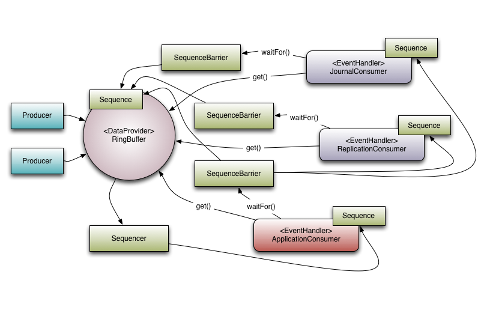

# 使用 Disruptor

> 译自 `src/docs/asciidoc/en/user-guide/10_using_the_disruptor.adoc`（LMAX Development Team 原著），示例代码取自 `src/examples/` 中的真实源码。

## 介绍

Disruptor 是一个提供并发环形缓冲数据结构的库，旨在为异步事件处理架构提供低延迟、高吞吐的工作队列。

要理解 Disruptor 的优势，可以拿一个大家熟知且用途相近的东西来对比——Java 的 `BlockingQueue`。和队列一样，Disruptor 的目的是在同一进程内的线程之间移动数据（消息或事件）。但 Disruptor 有几个区别于队列的关键特性：

- 向消费者**组播**事件，支持[消费者依赖图](#消费者依赖图)
- 事件的[内存预分配](#事件预分配)
- [可选无锁](#可选无锁)

### 核心概念

在理解 Disruptor 的工作原理之前，值得先定义一组贯穿文档和代码的术语。如果你熟悉 DDD（领域驱动设计），可以把这些看作 Disruptor 领域的"统一语言"。

- **Ring Buffer（环形缓冲）**：常被视为 Disruptor 的主体。但从 3.0 起，Ring Buffer 只负责存储和更新流经 Disruptor 的数据（Event）。在某些高级用例中，它甚至可以被用户完全替换。
- **Sequence（序号）**：Disruptor 用 Sequence 来标识某个组件的进度。每个消费者（Event Processor）都维护一个 Sequence，Disruptor 自身也是如此。绝大多数并发代码都依赖这些 Sequence 值的推进，因此 Sequence 支持 AtomicLong 的大部分特性。事实上两者唯一的实质区别是：Sequence 包含防止 Sequence 与其他值之间发生伪共享（false sharing）的额外功能。
- **Sequencer（序号协调器）**：Sequencer 才是 Disruptor 真正的核心。该接口的两个实现（单生产者、多生产者）实现了全部并发算法，用于在生产者与消费者之间快速、正确地传递数据。
- **Sequence Barrier（序号屏障）**：由 Sequencer 创建，持有来自 Sequencer 的主发布 Sequence 以及所有被依赖消费者的 Sequence 的引用。它包含判断"是否有可供消费者处理的事件"的逻辑。
- **Wait Strategy（等待策略）**：决定消费者如何等待生产者把事件放进 Disruptor。详见"可选无锁"一节。
- **Event（事件）**：从生产者传递到消费者的数据单元。代码中没有对 Event 的具体表示——它完全由用户定义。
- **Event Processor（事件处理器）**：处理 Disruptor 事件的主循环，拥有消费者的 Sequence。只有一个实现，叫 BatchEventProcessor，包含高效的事件循环实现，并回调用户提供的 EventHandler 接口实现。
- **Event Handler（事件处理器接口）**：由用户实现的接口，代表 Disruptor 的一个消费者。
- **Producer（生产者）**：调用 Disruptor 入队 Event 的用户代码。这个概念在代码中同样没有具体表示。

为了把这些元素放进上下文，下图展示了 LMAX 如何在其高性能核心服务（如交易所）中使用 Disruptor：



### 组播事件

这是队列与 Disruptor 之间最大的行为差异。

当多个消费者监听同一个 Disruptor 时，它会把**所有**事件发布给**所有**消费者。相比之下，队列只会把单个事件发给单个消费者。当你需要对同一份数据并行执行多个独立操作时，就可以利用 Disruptor 的这种行为。

**示例用例**：LMAX 的经典例子是三个操作——journalling（把输入数据写入持久化日志文件）、replication（把输入数据发送到另一台机器，确保数据有远程副本）、业务逻辑（真正的处理工作）。从上图可以看到有 3 个 EventHandler 在监听 Disruptor（JournalConsumer、ReplicationConsumer 和 ApplicationConsumer）。每个 Event Handler 都会收到 Disruptor 中*所有*的消息（按相同顺序），这使得每个消费者的工作可以并行进行。

### 消费者依赖图

为了支撑并行处理行为在真实世界中的应用，必须支持消费者之间的协调。回到上面的例子：必须阻止业务逻辑消费者在 journalling 和 replication 消费者完成各自任务之前取得进展。我们把这个概念称为"**gating**"（门控）。

"Gating"发生在两个地方：

- 首先，需要确保生产者不会甩开消费者跑过头。这通过把相关消费者注册到 Disruptor 来实现（译注：原文写作 `RingBuffer.addGatingConsumers()`，在 4.0 中对应 `addGatingSequences()`）。
- 其次，前面提到的消费者间依赖通过构造 SequenceBarrier 实现——把"必须先完成处理"的组件的 Sequence 装进屏障。

参照上图，有 3 个消费者在监听 Ring Buffer 的事件，本例中存在一张依赖图：ApplicationConsumer 依赖 JournalConsumer 和 ReplicationConsumer，这意味着后两者可以自由地彼此并行。依赖关系可以从 ApplicationConsumer 的 SequenceBarrier 连向 JournalConsumer 和 ReplicationConsumer 的 Sequence 的连接看出。

还值得注意的是 Sequencer 与下游消费者的关系。它的职责之一是确保发布不会回绕覆盖 Ring Buffer。为此，任何下游消费者的 Sequence 都不得低于"Ring Buffer 的 Sequence 减去 Ring Buffer 容量"。

然而，利用依赖图可以做出一个有趣的优化：因为 ApplicationConsumer 的 Sequence 保证小于等于 JournalConsumer 和 ReplicationConsumer 的 Sequence（这正是依赖关系所保证的），所以 Sequencer 只需要查看 ApplicationConsumer 的 Sequence。更一般地说，**Sequencer 只需要感知依赖树中叶子节点消费者的 Sequence**。

### 事件预分配

Disruptor 的目标之一是用于低延迟环境。在低延迟系统中，必须减少或消除内存分配。在 Java 系统中，目的是减少 GC 停顿的次数（译注：原文脚注——在低延迟 C/C++ 系统中，大量内存分配同样有问题，因为会给内存分配器带来争用）。

为此，用户可以在 Disruptor 内预分配事件所需的存储。构造时由用户提供一个 `EventFactory`，它会为 Ring Buffer 中的每个条目被调用一次。向 Disruptor 发布新数据时，API 允许用户拿到这个已构造的对象，从而在该存储对象上调用方法或更新字段。只要实现正确，Disruptor 保证这些操作是并发安全的。

### 可选无锁

另一个由低延迟诉求推动的实现细节是：Disruptor 大量使用了无锁算法。所有内存可见性和正确性保证都通过内存屏障和/或 CAS（compare-and-swap）操作实现。

> **注意**：唯一一个真正需要锁的用例是 `BlockingWaitStrategy`。使用锁的唯一目的是借助 condition，让消费线程在等待新事件到达时可以被挂起（park）。许多低延迟系统会使用忙等（busy-wait）来避免 condition 带来的抖动；但在一些系统中，忙等会显著降低性能，特别是在 CPU 资源紧张的环境里，例如虚拟化环境中的 Web 服务器。

## 入门

### 获取 Disruptor

Disruptor 的 jar 可以从 [Maven Central](https://search.maven.org/artifact/com.lmax/disruptor) 获取，可以集成到你选择的任何依赖管理工具中。

### 基本的生产与消费

我们从一个非常简单的人造例子开始：把一个 `long` 值从生产者传给消费者，消费者只是把值打印出来。

目前为 Disruptor 编写生产者和消费者有好几种风格。它们本质上相似，但每种方法都有细微差别，下面会逐一介绍。

首先定义 `Event`——承载数据、且对后面所有例子通用的类：

```java
public class LongEvent
{
    private long value;

    public void set(long value)
    {
        this.value = value;
    }

    @Override
    public String toString()
    {
        return "LongEvent{" + "value=" + value + '}';
    }
}
```

为了让 Disruptor 为我们预分配这些事件，需要一个 `EventFactory` 来执行构造。可以是方法引用（如 `LongEvent::new`），也可以是 `EventFactory` 接口的显式实现：

```java
public class LongEventFactory implements EventFactory<LongEvent>
{
    @Override
    public LongEvent newInstance()
    {
        return new LongEvent();
    }
}
```

定义好事件后，需要创建一个处理这些事件的消费者。作为示例，我们写一个把值打印到控制台的 `EventHandler`：

```java
public class LongEventHandler implements EventHandler<LongEvent>
{
    @Override
    public void onEvent(LongEvent event, long sequence, boolean endOfBatch)
    {
        System.out.println("Event: " + event);
    }
}
```

最后需要事件的来源。为简单起见，假设数据来自某种 I/O 设备（如网络或文件），以 `ByteBuffer` 的形式到达。

#### 发布

##### 使用 Lambda

从 Disruptor 3.0 起，可以用 Lambda 风格的 API 编写发布者。这是推荐方式，因为它封装了其他方案的大部分复杂性：

```java
public class LongEventMain
{
    public static void main(String[] args) throws Exception
    {
        int bufferSize = 1024; // <1>

        Disruptor<LongEvent> disruptor = // <2>
                new Disruptor<>(LongEvent::new, bufferSize, DaemonThreadFactory.INSTANCE);

        disruptor.handleEventsWith((event, sequence, endOfBatch) ->
                System.out.println("Event: " + event)); // <3>
        disruptor.start(); // <4>

        RingBuffer<LongEvent> ringBuffer = disruptor.getRingBuffer(); // <5>
        ByteBuffer bb = ByteBuffer.allocate(8);
        for (long l = 0; true; l++)
        {
            bb.putLong(0, l);
            ringBuffer.publishEvent((event, sequence, buffer) -> event.set(buffer.getLong(0)), bb);
            Thread.sleep(1000);
        }
    }
}
```

1. 指定 Ring Buffer 的大小，必须是 2 的幂
2. 构造 Disruptor
3. 连接处理器
4. 启动 Disruptor，所有线程开始运行
5. 从 Disruptor 获取 Ring Buffer，用于发布

> **警告**：注意 `publishEvent()` 所用的 lambda 只引用了传入的参数。如果把代码写成这样：
>
> ```java
> ByteBuffer bb = ByteBuffer.allocate(8);
> for (long l = 0; true; l++)
> {
>     bb.putLong(0, l);
>     ringBuffer.publishEvent((event, sequence) -> event.set(bb.getLong(0)));
>     Thread.sleep(1000);
> }
> ```
>
> 这就创建了一个**捕获型 lambda**——它需要在传递给 `publishEvent()` 时实例化一个对象来持有 `ByteBuffer bb` 变量，从而产生额外（不必要的）垃圾。如果对 GC 压力有要求，应优先选择把参数透传进 lambda 的调用方式。

由于可以用方法引用代替匿名 lambda，这个例子也可以改写成：

```java
public class LongEventMain
{
    public static void handleEvent(LongEvent event, long sequence, boolean endOfBatch)
    {
        System.out.println(event);
    }

    public static void translate(LongEvent event, long sequence, ByteBuffer buffer)
    {
        event.set(buffer.getLong(0));
    }

    public static void main(String[] args) throws Exception
    {
        int bufferSize = 1024;

        Disruptor<LongEvent> disruptor =
                new Disruptor<>(LongEvent::new, bufferSize, DaemonThreadFactory.INSTANCE);
        disruptor.handleEventsWith(LongEventMain::handleEvent);
        disruptor.start();

        RingBuffer<LongEvent> ringBuffer = disruptor.getRingBuffer();
        ByteBuffer bb = ByteBuffer.allocate(8);
        for (long l = 0; true; l++)
        {
            bb.putLong(0, l);
            ringBuffer.publishEvent(LongEventMain::translate, bb);
            Thread.sleep(1000);
        }
    }
}
```

##### 使用 Translator

在 3.0 之前，发布消息的首选方式是通过 Event Publisher / Event Translator 接口：

```java
public class LongEventProducer
{
    private final RingBuffer<LongEvent> ringBuffer;

    public LongEventProducer(RingBuffer<LongEvent> ringBuffer)
    {
        this.ringBuffer = ringBuffer;
    }

    private static final EventTranslatorOneArg<LongEvent, ByteBuffer> TRANSLATOR =
        new EventTranslatorOneArg<LongEvent, ByteBuffer>()
        {
            @Override
            public void translateTo(LongEvent event, long sequence, ByteBuffer bb)
            {
                event.set(bb.getLong(0));
            }
        };

    public void onData(ByteBuffer bb)
    {
        ringBuffer.publishEvent(TRANSLATOR, bb);
    }
}
```

这种方式会用到一些额外的类（如 handler、translator），而使用 lambda 时并不强制要求它们。它的优势在于 translator 代码可以抽到独立的类中，便于单元测试。

Disruptor 提供了多个不同的 translator 接口（`EventTranslator`、`EventTranslatorOneArg`、`EventTranslatorTwoArg` 等），以便 translator 可以用静态类和 lambda 表示（见上文）。翻译方法的参数通过 Ring Buffer 上的调用透传给 translator。

#### 使用 Legacy API 发布

还有一种更"原始"的方式：

```java
public class LongEventProducer
{
    private final RingBuffer<LongEvent> ringBuffer;

    public LongEventProducer(RingBuffer<LongEvent> ringBuffer)
    {
        this.ringBuffer = ringBuffer;
    }

    public void onData(ByteBuffer bb)
    {
        long sequence = ringBuffer.next(); // <1>
        try
        {
            LongEvent event = ringBuffer.get(sequence); // <2>
            event.set(bb.getLong(0));  // <3>
        }
        finally
        {
            ringBuffer.publish(sequence);
        }
    }
}
```

1. 申领下一个序号
2. 取出 Disruptor 中该序号对应的条目
3. 把数据填入条目

显而易见，事件发布比用简单的队列更繁琐。这是事件预分配的代价：它要求（在最底层）两阶段的消息发布——先申领 Ring Buffer 中的槽位，然后发布可用的数据。

> **注意**：发布必须包裹在 `try`/`finally` 块中。如果我们申领了 Ring Buffer 的一个槽位（调用 `RingBuffer#next()`），就必须发布这个序号。否则可能损坏 Disruptor 的状态——具体来说，在多生产者场景下，这会导致消费者停滞，不重启就无法恢复。因此推荐使用 lambda 或 EventTranslator API。

最后一步是把所有组件装配起来。虽然可以手动装配每个组件，但这很复杂，因此提供了一个 DSL 来简化构造。

> **提示**：DSL 无法使用一些更复杂的选项，但它适合绝大多数场景。

```java
public class LongEventMain
{
    public static void main(String[] args) throws Exception
    {
        LongEventFactory factory = new LongEventFactory();

        int bufferSize = 1024;
        Disruptor<LongEvent> disruptor =
                new Disruptor<>(factory, bufferSize, DaemonThreadFactory.INSTANCE);
        disruptor.handleEventsWith(new LongEventHandler());
        disruptor.start();

        RingBuffer<LongEvent> ringBuffer = disruptor.getRingBuffer();
        LongEventProducer producer = new LongEventProducer(ringBuffer);
        ByteBuffer bb = ByteBuffer.allocate(8);
        for (long l = 0; true; l++)
        {
            bb.putLong(0, l);
            producer.onData(bb);
            Thread.sleep(1);
        }
    }
}
```

### 基本调优选项

上面的方式能在最广泛的部署场景下正常工作。不过有一些调优选项可以用来提升性能，两个主要选项是：

- [单生产者 vs 多生产者](#单生产者-vs-多生产者)
- [替代等待策略](#替代等待策略)

这两个选项都在构造 Disruptor 时设置：

```java
public class LongEventMain
{
    public static void main(final String[] args)
    {
        //.....
        Disruptor<LongEvent> disruptor = new Disruptor(
            factory,
            bufferSize,
            DaemonThreadFactory.INSTANCE,
            ProducerType.SINGLE, // <1>
            new BlockingWaitStrategy() // <2>
        );
        //.....
    }
}
```

1. 用 `ProducerType#SINGLE` 创建 `SingleProducerSequencer`；用 `ProducerType#MULTI` 创建 `MultiProducerSequencer`（译注：原文误作 MultiProducerSequence）
2. 设置所需的 `WaitStrategy`

#### 单生产者 vs 多生产者

提升并发系统性能的最佳方法之一是遵守[单写者原则](https://mechanical-sympathy.blogspot.com/2011/09/single-writer-principle.html)，这一点同样适用于 Disruptor。如果你的场景永远只有一个线程向 Disruptor 生产事件，就可以利用这一点获得额外性能。

为了展示这项技术能带来多大的性能优势，可以修改 OneToOne 性能测试的生产者类型。测试运行于 i7 Sandy Bridge MacBook Air（译注：2011 年的硬件，绝对数字仅供历史参考，但约 3 倍的相对差距仍然成立）：

**多生产者**：

| 运行 | 吞吐 |
|---|---|
| Run 0 | 26,553,372 ops/sec |
| Run 1 | 28,727,377 ops/sec |
| Run 2 | 29,806,259 ops/sec |
| Run 3 | 29,717,682 ops/sec |
| Run 4 | 28,818,443 ops/sec |
| Run 5 | 29,103,608 ops/sec |
| Run 6 | 29,239,766 ops/sec |

**单生产者**：

| 运行 | 吞吐 |
|---|---|
| Run 0 | 89,365,504 ops/sec |
| Run 1 | 77,579,519 ops/sec |
| Run 2 | 78,678,206 ops/sec |
| Run 3 | 80,840,743 ops/sec |
| Run 4 | 81,037,277 ops/sec |
| Run 5 | 81,168,831 ops/sec |
| Run 6 | 81,699,346 ops/sec |

#### 替代等待策略

Disruptor 默认使用 `BlockingWaitStrategy`。它内部用典型的锁 + 条件变量来处理线程唤醒。`BlockingWaitStrategy` 是所有等待策略中最慢的，但在 CPU 使用上最保守，能在最广泛的部署环境中给出最一致的行为。

了解部署系统的情况，可以通过选择更合适的等待策略获得额外性能：

- **SleepingWaitStrategy** —— 和 `BlockingWaitStrategy` 一样试图节约 CPU，使用简单的忙等循环；区别是循环中间会调用 `LockSupport.parkNanos(1)`。在典型 Linux 系统上这会让线程暂停约 60µs。好处是生产者线程除了递增计数器外无需任何动作，也无需承担条件变量信号的开销；代价是事件从生产者到消费者的平均延迟更高。最适合不需要低延迟、但希望对生产者线程影响小的场景，常见用例是异步日志。
- **YieldingWaitStrategy** —— 两种可用于低延迟系统的 WaitStrategy 之一，适用于可以燃烧 CPU 周期来换取延迟的场景。它会忙等序号递增到合适的值，循环体内调用 `Thread#yield()` 让其他排队线程运行。当你需要极高性能、且 EventHandler 线程数小于逻辑核总数时（如开启了超线程），这是推荐的等待策略。
- **BusySpinWaitStrategy** —— 性能最高的 WaitStrategy。和 YieldingWaitStrategy 一样可用于低延迟系统，但对部署环境的约束最高：只有当 EventHandler 线程数小于机器的物理核数时才应使用（例如应关闭超线程）。

### 清理 Ring Buffer 中的对象

通过 Disruptor 传递数据时，对象的存活时间可能比预期更长。为避免这种情况，可能需要在使用后清空事件。

如果只有一个事件处理器，在同一个处理器里清空值就够了；如果有一条处理器链，则可能需要在链尾放一个专门的处理器负责清空对象：

```java
class ObjectEvent<T>
{
    T val;

    void clear()
    {
        val = null;
    }
}
```

```java
public class ClearingEventHandler<T> implements EventHandler<ObjectEvent<T>>
{
    @Override
    public void onEvent(ObjectEvent<T> event, long sequence, boolean endOfBatch)
    {
        event.clear(); // <1>
    }
}
```

1. 如果不在这里调用 `clear()`，事件关联的对象会一直存活到被覆盖为止——要等到 Ring Buffer 回绕一圈回到起点才会发生。

```java
public static void main(String[] args)
{
    Disruptor<ObjectEvent<String>> disruptor = new Disruptor<>(
            () -> new ObjectEvent<>(), BUFFER_SIZE, DaemonThreadFactory.INSTANCE);

    disruptor
            .handleEventsWith(new ProcessingEventHandler())
            .then(new ClearingEventHandler());
}
```

## 高级技巧

### 处理大批次

"提前释放（Early Release）"示例：

```java
public class EarlyReleaseHandler implements EventHandler<LongEvent>
{
    private Sequence sequenceCallback;
    private int batchRemaining = 20;

    @Override
    public void setSequenceCallback(final Sequence sequenceCallback)
    {
        this.sequenceCallback = sequenceCallback;
    }

    @Override
    public void onEvent(final LongEvent event, final long sequence, final boolean endOfBatch)
    {
        processEvent(event);

        boolean logicalChunkOfWorkComplete = isLogicalChunkOfWorkComplete();
        if (logicalChunkOfWorkComplete)
        {
            sequenceCallback.set(sequence);
        }

        batchRemaining = logicalChunkOfWorkComplete || endOfBatch ? 20 : batchRemaining;
    }

    private boolean isLogicalChunkOfWorkComplete()
    {
        // 根据更小工作块所需的任何标准返回 true 或 false。如果涉及 I/O，
        // 可能是在 flush/sync 到磁盘之后，或在数据库批处理+提交结束时。
        // 也可以简单地按更小的批次大小工作。

        return --batchRemaining == -1;
    }

    private void processEvent(final LongEvent event)
    {
        // 执行处理
    }
}
```

译注：这个技巧的关键是 `sequenceCallback.set(sequence)`——消费进度序号不必等到整批结束才推进。在一个"逻辑工作块"完成时（例如每 20 个事件做一次 I/O flush）就提前推进自己的 Sequence，生产者就能更早地复用这些槽位，降低被慢消费者卡住的风险。

---

> 译注（原文档状态）：本指南的概念部分至今仍是理解 Disruptor 的最佳材料，但个别 API 名称（如 `addGatingConsumers()`）和性能数据停留在 3.x/2011 时代；4.0 新增的批回退（rewind）、maxBatchSize 等特性未在本文覆盖，可参阅 `40_batch_rewind_use_case.adoc`。
